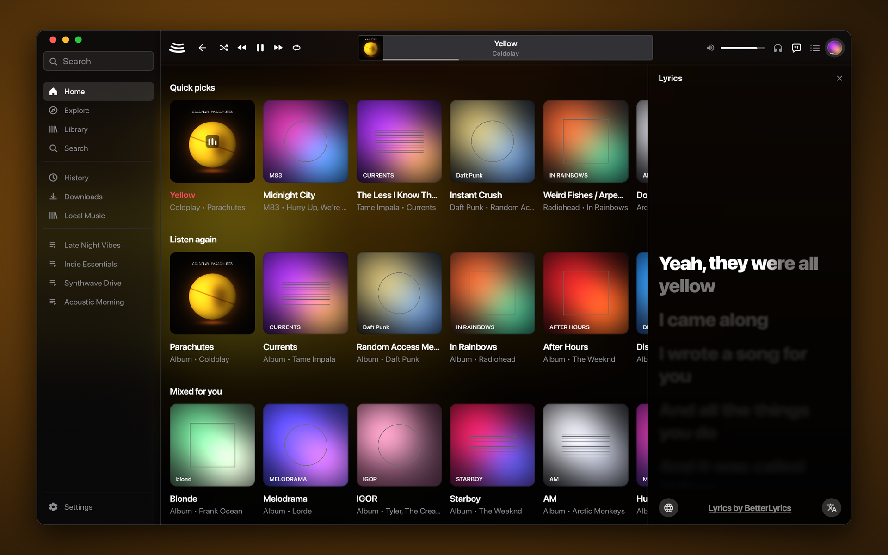
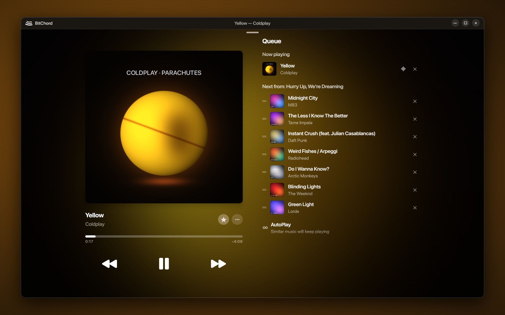

 
 

# BitChord

### Aesthetic YouTube Music Client for Android, Android TV, Wear OS, Windows, macOS & Linux

 

 

[**Download**](#download) · [**What's Extra**](#whats-extra) · [**Features**](#features) · [**Desktop**](#desktop) · [**Contributing**](#contributing) · [**Support**](#support) · [**Disclaimer**](#disclaimer)

 

> [!IMPORTANT]
> BitChord is not affiliated with, endorsed by, or connected to YouTube or Google in any way. Use it at your own discretion.

---

 
 

<table>
  <tr>
    <td width="50%" align="center">
      
       
      <b>macOS (Apple Silicon & Intel)</b> — Native traffic-light toolbar, Home shelves & word-synced lyrics side panel
    </td>
    <td width="50%" align="center">
      
       
      <b>Linux & Windows</b> — Full-window landscape Now Playing with motion canvas, mesh backdrop & live queue
    </td>
  </tr>
</table>

---

<h1>Download</h1>

  
  &nbsp;
  
  &nbsp;
  
  &nbsp;
  

| Platform | Architectures | Packages on [Releases](https://github.com/Inventor365/BitChord/releases/latest) |
| :--- | :--- | :--- |
| **Android (Phone & Tablet)** | Universal, `arm64-v8a`, `armeabi-v7a`, `x86_64` | `BitChord-v1.8.2.apk`, `BitChord-v1.8.2_<abi>.apk` |
| **Android TV / Fire TV** | Universal, `arm64-v8a`, `armeabi-v7a`, `x86_64` | `BitChordTV-v1.8.2.apk`, `BitChordTV-v1.8.2_<abi>.apk` |
| **Wear OS** | Universal | `BitChordWear-v1.8.2.apk` (also embedded in the phone APK) |
| **Windows 10 / 11** | `x64` | `BitChord-1.8.2-windows-x64-setup.exe`, `.msi`, `-portable.zip` |
| **macOS 12+** | Apple Silicon (`arm64`) & Intel (`x64`) | `BitChord-1.8.2-macos-arm64.dmg` / `.pkg` / `.zip`, `macos-x64.dmg` / `.pkg` / `.zip` |
| **Linux** | `x86_64` / `amd64` | `BitChord-1.8.2-linux-x86_64.AppImage`, `-linux-amd64.deb`, `-linux-x86_64.rpm` |

For detailed desktop build and packaging instructions, see [DESKTOP.md](DESKTOP.md).

---

<h1>What's Extra Over Official</h1>

This repository tracks [`kushagrasinghx/BitChord`](https://github.com/kushagrasinghx/BitChord) (`v1.8.2` + `web-player`) while restoring the native desktop client and integrating high-value community pull requests ahead of upstream:

- **Native Desktop Client Restored (`:desktopApp` & `:desktopUi`)**:
  - Native packages for **Windows (`x64` `.exe`, `.msi`, `portable.zip`)**, **macOS (`arm64` & `x64` `.dmg`, `.pkg`, `.zip`)**, and **Linux (`x86_64` `.AppImage`, `.deb`, `.rpm`)**.
  - Native audio output (`WASAPI`, `CoreAudio`, `ALSA`/`PulseAudio`/`PipeWire`), 10-band parametric EQ, system media integration (`SMTC`, `MPRIS2`, macOS Now Playing), Discord Rich Presence IPC, and local Beat This! (`final0`) ONNX Automix analysis.
- **Waveform-Aligned Lossless Upgrades (`#1036`)**: Cross-correlates audio envelopes between the playing stream and the incoming lossless upgrade on a standby deck, handing over with an equal-power crossfade so stream upgrades never skip or click.
- **TorBox Debrid Cloud Cache (`#1161`)**: Stream bit-exact FLAC, ALAC, Dolby Atmos, and AC-4 tracks from your TorBox library or global cache, and cache addon streams into your account.
- **External Music Links (`#1145`)**: Open Spotify, Apple Music, Deezer, and SoundCloud links directly inside BitChord, matched automatically on YouTube Music.
- **Save Queue & Radio as Playlist (`#1174`)**: Save your current queue or active radio session as a new playlist in one tap.
- **Samsung Galaxy Buds Control Panel (`#983`)**: Control ANC, Ambient Sound, 360 Audio, equalizer presets, and view earbud/case battery levels directly from the player's audio output sheet.
- **Lossless Audio Upgrade for Video Streams & TV (`#972`)**: Upgrades music-video tracks to studio lossless audio (accounting for video intro/outro duration drift) and brings lossless upgrades to BitChord TV.
- **Chromecast Queue Window & Downloaded Track Casting (`#1186`)**: Casts bounded queue windows, resolves downloaded tracks to their remote stream URLs for Chromecast, and keeps cast session state accurate.
- **Android TV Low-Memory Performance Mode (`#1044`)**: Adaptive artwork sizing and memory budgets for smooth playback and navigation on low-RAM Android TV and Fire TV devices.
- **Privacy & Customization Enhancements**:
  - **Block Explicit Songs (`#801`)** with queue/AutoPlay filtering and allow-once prompts.
  - **Fully Disable Song Caching (`#985`)** (`0 MB` option + custom step slider).
  - **Auto-Download Playlist Songs (`#935`)** when adding tracks to downloaded playlists.
  - **Icon-Only Bottom Navigation Bar (`#907`)** toggle in Settings.
  - **Fully Anonymous Search & Pagination (`#939`)** so searches never pollute YouTube Music history.
  - **Per-Track Local Cover Art (`#1188`)** and **Embedded ID3 Lyrics (`#1119`)** for local MP3 libraries.

---

<h1>Features</h1>

<table>
  <tr>
    <td width="50%" valign="top">

#### Playback & Audio Engine
- **Search, browse and play** anything available on YouTube Music — songs, albums, playlists, artists, and full **music videos up to 4K**.
- **Hi-Res lossless audio** — FLAC/ALAC/Dolby Atmos from configured module/addon/Debrid sources, with waveform-aligned handover from YouTube Music.
- **Gapless playback with true crossfade**, adjustable 0–12s.
- **Automix & Loop Mix** — Beat-matched, key-aware, and vocal-aware DJ transitions powered by Beat This! (`final0`) and Signalsmith time-stretching, with an interactive Mix View popup.
- **Offline downloads & Offline Player** — Save tracks with embedded metadata/lyrics, assemble DASH/HLS manifests into `.flac`, and browse local folders and device playlists offline.
- **Open links from other apps** — Spotify, Apple Music, Deezer and SoundCloud track, album and playlist links play here, matched on YouTube Music.
- **Save queue & radio as playlist** — Turn any queue or radio station into a saved playlist.

#### Connectivity & Accounts
- **Sign in with your Google account** (including brand channels) for personalized content and library sync.
- **Listen Together** — Synchronized listening parties with host controls, QR/link invites, and live activity feed.
- **Spotify integration** — Connect your account to play and import your playlists and Liked Songs.
- **Discord Rich Presence** — Live track, artist, album art, audio quality badge, and seek-accurate progress on Android, Desktop, and Web.
- **Scrobbling** to Last.fm and ListenBrainz.
- **Pluggable sources & Debrid** — Add, edit, test, and prioritize module/addon sources plus TorBox Debrid cloud caching.

    </td>
    <td width="50%" valign="top">

#### Experience & Design
- **Liquid Glass UI** — Apple-inspired Liquid Glass bars with edge refraction, adaptive glyph contrast, progressive status-bar blur, and squircle segmented tabs.
- **Animated album canvas** — 3:4 motion artwork on mobile and square motion sleeves on desktop/landscape.
- **Apple-like word-synced lyrics** — Syllable/word-level sweep, duet alignment, live translation, Romanization, and Vazirmatn Persian font support. Credit to [binimum](https://github.com/binimum/am-lyrics).
- **12 Lyrics providers** — [lrc.red](https://lrc.red), [BiniLyrics](https://github.com/binimum), [BetterLyrics](https://github.com/better-lyrics/better-lyrics), [PaxSenix](https://lyrics.paxsenix.org), [LyricsPlus](https://github.com/ibratabian17/YouLyPlus), [SimpMusic](https://github.com/maxrave-dev/SimpMusic), [Unison](https://unison.boidu.dev), [Megalobiz](https://www.megalobiz.com), [KuGou](https://www.kugou.com), [LRCLIB](https://lrclib.net), [Musixmatch](https://www.musixmatch.com), and [Genius](https://genius.com), plus embedded ID3/FLAC tags.
- **Dynamic artwork-driven theming** — Real-time mesh gradient backdrops extracted from cover art.
- **17 Languages** — English, German, Spanish, French, Hebrew, Hindi, Indonesian, Italian, Japanese, Korean, Polish, Portuguese, Russian, Thai, Turkish, Simplified Chinese, and Traditional Chinese.

#### Controls, Hardware & Tweaks
- **Galaxy Buds & Hi-Res Bluetooth** — Built-in Galaxy Buds noise/EQ/battery panel, 24-bit float Bluetooth preservation, and USB DAC bit-perfect mode.
- **Per-network audio quality** — Separate quality ceilings for Wi-Fi and mobile data, plus Direct Source Stream mode.
- **Playback speed & pitch control** (0.5×–2.0×) and **skip silence**.
- **Custom sleep timer** — 5 minutes to 12 hours, or "stop after this track".
- **Equalizer & Limiter** — System & built-in multiband EQ with peak limiting.
- **Stats for nerds** — Live codec, bit depth, sample rate, source name, and waveform alignment offset on the player.

    </td>
  </tr>
</table>

---

<h1>Contributing</h1>

We welcome contributions to BitChord! Please review our [Contributing Guide](CONTRIBUTING.md) and [Code of Conduct](CODE_OF_CONDUCT.md) before submitting a Pull Request.

[**Contributing Guide**](CONTRIBUTING.md) · [**Code of Conduct**](CODE_OF_CONDUCT.md) · [**Maintainers**](MAINTAINERS.md) · [**Additional Docs**](ADDITIONAL.md)

### Thanks to all contributors ❤

---

<h1>Support</h1>

BitChord is free and always will be — if it's earned a spot in your rotation, you can chip in to the upstream creator here:

 

---

<h1>Disclaimer & Legal Notice</h1>

BitChord is an independent, community-driven third-party audio player and client. It is **not** associated with Google LLC, YouTube Music, Deezer, Telegram, or any of their parent companies.

* **No Media Hosting:** BitChord does not host, upload, or store copyrighted music files. It operates strictly as an interface to scan local device storage or stream media directly from public, public-facing, or user-authenticated APIs.
* **Fair Use & API Usage:** This software is created solely for personal research, educational, and fair-use purposes. The user is entirely responsible for ensuring their usage aligns with their local copyright laws and YouTube Terms of Service.
* **No Ad-Blocking Guarantee:** While BitChord focuses on providing a clean listening environment, it does not guarantee permanent bypasses or modifications to commercial third-party platform conditions.
* **Copyleft:** BitChord is free software under the GPLv3. The license does not let anyone forbid others from selling or redistributing copies, but any distribution must come with the Corresponding Source under the same license.

---

<h1>License</h1>

This project is licensed under the **GNU General Public License v3.0 (GPLv3)**. See the [LICENSE](LICENSE) file for details.

